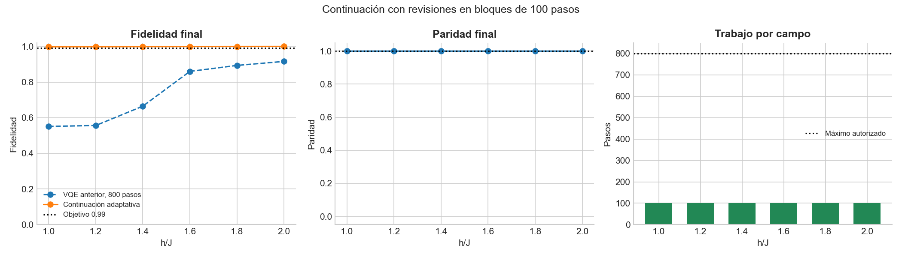

<p align="center">
  
</p>

# Challenge 3: Simulación de materiales para dispositivos de energía de próxima generación

Repositorio preparado para el **Track 3 / Challenge 3 del Quantathon CR 2026**. El reto consiste en simular materiales cuánticos que podrían ser relevantes para energía del futuro, como superconductores, baterías y catalizadores.

El núcleo de la entrega es el **Modelo de Ising de Campo Transverso (TFIM)**. Como extensión opcional se incluye un sistema pequeño del **modelo de Fermi-Hubbard**, útil para discutir electrones fuertemente correlacionados y el régimen de Mott.

ODS: **7, 9, 12 y 13**. La conexión física es que una mejor simulación de materiales puede apoyar energía más limpia, almacenamiento más eficiente, infraestructura científica y menor huella de carbono.

## Integrantes

- Benjamín Sánchez Hernández
- Arantxa Camil Junco Flores
- Amado Alberto Cabrera Estrada
- Mariana Elizabeth Perez
- Natalia Amortegui Castaño

## Informe técnico

El informe de la entrega original se encuentra en [`reports/informe_tecnico_track_3.pdf`](reports/informe_tecnico_track_3.pdf). La actualización de los VQE del **15 de noviembre de 2026**, que complementa ese PDF, está documentada en [la bitácora experimental](reports/bitacora_tfim_2026-11-15.md) y en [el informe Markdown actualizado](reports/informe_tecnico_borrador.md).

## Estructura del repositorio

```text
Track3_Simulacion_Materiales/
├─ README.md
├─ requirements.txt
├─ run_all.py
├─ notebooks/
│  ├─ 01_tfim_trotter_ed_vqe.ipynb
│  └─ 02_fermi_hubbard_opcional.ipynb
├─ src/
│  ├─ tfim/
│  │  └─ funciones_ising_hackathon.py
│  └─ fermi_hubbard/
│     └─ Funciones_F_h.py
├─ docs/
│  ├─ Track3.pdf
│  ├─ marco_teorico.md
│  ├─ track3_checklist.md
│  └─ toolkit_statement.md
├─ reports/
│  ├─ informe_tecnico_borrador.md
│  ├─ informe_tecnico_track_3.pdf
│  └─ presentacion_5min_outline.md
└─ figures/
   └─ README.md
```

Los notebooks se separaron de las funciones para que el código sea más reproducible: los notebooks contienen parámetros, ejecución, tablas, figuras e interpretación; `src/` contiene las rutinas usadas para obtener los resultados.

## Instalación

Desde esta carpeta:

```bash
python -m venv .venv
.venv\Scripts\activate
pip install -r requirements.txt
```

En macOS/Linux:

```bash
source .venv/bin/activate
```

## Dry run

Para verificar qué se ejecutaría sin correr simulaciones:

```bash
python run_all.py --dry-run
```

La dry run no ejecuta notebooks, no corre VQE y no genera archivos nuevos. Solo reporta cuántas celdas de código tiene cada notebook y cuántas celdas VQE serán omitidas.

## Punto de entrada reproducible

Para ejecutar los notebooks y guardar copias ejecutadas:

```bash
python run_all.py
```

Por indicación del flujo de trabajo actual, `run_all.py` **omite las celdas VQE** etiquetadas como `skip-vqe`. Esto permite reproducir Trotter, diagonalización exacta, barridos no variacionales, tablas y gráficas sin lanzar optimizaciones VQE largas. El código VQE queda escrito en los notebooks fuente para ejecutarse manualmente en el interior del Notebook.

Las copias ejecutadas se guardan en:

```text
executed_notebooks/
```

## Planteamiento del problema

El Track 3 pide:

1. Implementar la evolución temporal trotterizada del TFIM en 1D.
2. Graficar $\langle Z\rangle$ y $\langle Z_iZ_j\rangle$ contra tiempo desde un estado producto inicial.
3. Barrer $h/J\in\{0.5,1.0,2.0\}$ a través de la transición de fase.
4. Comparar frente a diagonalización exacta para una cadena de 6 qubits.
5. Opcionalmente, usar VQE para estimar la energía del estado fundamental.

El notebook principal cubre esos puntos. El notebook de Fermi-Hubbard queda como extensión opcional.

## Modelo TFIM

El TFIM describe una red de espines con acoplamientos $ZZ$ entre vecinos y un campo magnético transverso:

$$
H=-J\sum_i Z_iZ_{i+1}-h\sum_i X_i.
$$

La interacción $J$ favorece alineación ferromagnética en $Z$, mientras que el campo $h$ introduce fluctuaciones cuánticas en $X$. En el límite termodinámico la transición de fase ocurre en:

$$
h/J=1.
$$

En cadenas finitas, como $N=6$, la transición se observa redondeada.

## Resultados TFIM

Resultados de referencia obtenidos en los notebooks fuente:

| Prueba | Resultado |
|:--|:--|
| Degradación Trotter | $F(r,2r)$ baja de `0.977711` para $N=4$ a `0.949215` para $N=12$. |
| Dinámica $h/J=0.5$ | Fidelidad mínima Trotter-ED `0.981615`. |
| Dinámica $h/J=1.0$ | Fidelidad mínima Trotter-ED `0.964284`. |
| Dinámica $h/J=2.0$ | Fidelidad mínima Trotter-ED `0.920426`. |
| ED $N=6$, $h/J=0.5$ | $E_0/N=-1.064116$, $\sqrt{\langle M_z^2\rangle}=0.969914$. |
| ED $N=6$, $h/J=1.0$ | $E_0/N=-1.287901$, $\sqrt{\langle M_z^2\rangle}=0.813220$. |
| ED $N=6$, $h/J=2.0$ | $E_0/N=-2.128232$, $\sqrt{\langle M_z^2\rangle}=0.554173$. |

### VQE: resultados consolidados al 15 de noviembre de 2026

Los diez campos estudiados tienen un resultado guardado con **fidelidad superior al 99 %** frente al fundamental de diagonalización exacta. La fidelidad es el solapamiento al cuadrado entre ambos estados.

| h/J | Fidelidad final | Paridad | Error absoluto de energía | Pasos del resultado | Inicio |
|---:|---:|---:|---:|---:|:--|
| 0.2 | 0.999788 | 0.999857 | 0.001008 | 800 | semilla 3; dos reinicios |
| 0.4 | 0.998895 | 0.999972 | 0.003997 | 800 | semilla 42; dos reinicios |
| 0.6 | 0.998948 | 0.999992 | 0.005217 | 800 | semilla 42; dos reinicios |
| 0.8 | 0.998505 | 0.999981 | 0.009777 | 800 | parámetros de 0.6 |
| 1.0 | 0.997967 | 0.999999 | 0.014043 | 100 | parámetros de 0.8 |
| 1.2 | 0.998219 | 0.999999 | 0.012284 | 100 | parámetros de 1.0 |
| 1.4 | 0.998818 | 1.000000 | 0.008603 | 100 | parámetros de 1.2 |
| 1.6 | 0.999274 | 1.000000 | 0.005686 | 100 | parámetros de 1.4 |
| 1.8 | 0.999561 | 1.000000 | 0.003768 | 100 | parámetros de 1.6 |
| 2.0 | 0.999728 | 1.000000 | 0.002562 | 100 | parámetros de 1.8 |

La tabla reúne tres ejecuciones: reinicios independientes con dos semillas en 0.2, 0.4 y 0.6; la prueba puntual 0.6 → 0.8 con 800 pasos; y la continuación adaptativa 0.8 → 1.0 → … → 2.0. Los pasos corresponden al entrenamiento del resultado seleccionado de cada campo. Las cifras completas y su procedencia están en [`reports/tfim_vqe_resultados_finales.csv`](reports/tfim_vqe_resultados_finales.csv).

### Qué cambió y por qué

El costo incorpora paridad positiva: `L(θ) = ⟨H⟩ + λ(1 − ⟨P⟩)/2`, con `P = X₀X₁X₂X₃X₄X₅` y `λ = J = 1`. Se mantuvieron seis espines, tres capas de rotaciones RX/RY/RZ y anillos de CNOT, y Adam con tasa 0.03.

**Benjamín Sánchez Hernández propuso reutilizar los parámetros optimizados de un campo como inicio del siguiente**, aprovechando la cercanía entre fundamentales vecinos y el cambio suave del TFIM de seis espines. En la prueba 0.6 → 0.8, la fidelidad mejoró de **0.655755 a 0.998505** con el mismo circuito y costo.

Después se aplicó su criterio práctico: buscar fidelidad superior al 99 %, revisar cada 100 pasos y detener también los entrenamientos estancados para continuar el barrido. El estancamiento se implementó como cambios absolutos menores que 0.0001 en fidelidad y en pérdida media durante dos comparaciones de bloque consecutivas. El máximo se fijó en 800 pasos por campo. Adam conserva sus momentos entre bloques y se reinicia al cambiar de campo.

**Los seis campos de 1.0 a 2.0 superaron el objetivo en el primer bloque: 100 pasos cada uno, 600 en total.** Imponer 800 por campo habría requerido 4800 pasos para ese mismo tramo. Ningún caso necesitó detenerse por estancamiento. La referencia exacta se utiliza para evaluar la fidelidad y la parada de este benchmark de seis espines; el objetivo optimizado sigue siendo energía más penalización.



La bitácora conserva los ensayos anteriores: la penalización por sí sola dejó campos medios con fidelidad baja, y duplicar de 800 a 1600 pasos en campos altos no produjo una mejora apreciable. Esto distingue la precisión del estado de la convergencia numérica estricta del optimizador.

### Reproducción y trazabilidad

```bash
python scripts/continuar_tfim_adaptativo.py
python scripts/generar_resumen_tfim.py
python -m unittest discover -s tests -v
```

El primer comando utiliza el resultado local de 0.8 y repite la continuación adaptativa. En un clon nuevo, ejecutar primero las celdas de importación y parámetros, el barrido VQE de la sección 5 y la prueba puntual 0.6 → 0.8 de la sección 7 del notebook principal. Esas celdas generan los archivos NPZ que consumen los scripts. El repositorio publica código, tablas CSV y figuras; los archivos NPZ con estados, parámetros e historiales se generan y conservan localmente.

- [Bitácora y complemento del informe, 2026-11-15](reports/bitacora_tfim_2026-11-15.md): hipótesis, decisiones, ensayos y alcance.
- [Continuación adaptativa](reports/tfim_vqe_continuacion_adaptativa.csv) y [revisiones por bloque](reports/tfim_vqe_continuacion_adaptativa/bloques.csv).
- [Prueba puntual 0.6 → 0.8](reports/tfim_vqe_warm_start_08.csv).
- [Reinicios independientes con penalización](reports/tfim_vqe_paridad.csv) y [comparación 800/1600 pasos](reports/tfim_vqe_convergencia_1600.csv).
- [Galería de figuras](figures/README.md) y [notebook con ejecuciones y análisis](notebooks/01_tfim_trotter_ed_vqe.ipynb).

## Fermi-Hubbard opcional

El hamiltoniano de Fermi-Hubbard modela salto de fermiones y penalización por doble ocupación:

$$
H=-t\sum_{\langle i,j\rangle,\sigma}
(c^\dagger_{i\sigma}c_{j\sigma}+h.c.)
+U\sum_i n_{i\uparrow}n_{i\downarrow}.
$$

El notebook opcional estudia dinámica, diagonalización exacta, doble ocupación, densidad, $S(\pi)$ y VQE escrito para ejecución manual.

Resultados de referencia:

| Prueba | Resultado |
|:--|:--|
| Error Trotter | RMSE baja de `0.03881` con `r=2` a `0.00374` con `r=20`. |
| VQE Fermi-Hubbard | Fidelidad entre `0.999961` y `1.000000` en el barrido $U/J=0,\ldots,9$. |
| Régimen de Mott | La doble ocupación baja de `0.250000` a `0.021547` al aumentar $U/J$. |
| Orden antiferromagnético | $S(\pi)$ sube de `0.250000` a `0.478453`. |

## Limitaciones honestas

- No se afirma ventaja cuántica.
- La diagonalización exacta y métodos clásicos como redes tensoriales siguen siendo más fuertes para estos tamaños.
- Los resultados son de simulación ideal, sin ruido de hardware.
- El Fermi-Hubbard incluido es una extensión pequeña, no una red 4x4 completa.
- Los VQE están escritos, pero `run_all.py` no los ejecuta por defecto.
- La transición en $h/J=1$ está redondeada por tamaño finito.

## Pendiente adicional

- Preparar la presentación de 5 minutos.
- Si se desea competir con stack Quantinuum estricto, migrar la ejecución final a Pytket y/o Guppy y correr en emulador H2.

## Referencias

1. S. Sachdev, *Quantum Phase Transitions*, 2nd ed., Cambridge University Press, 2011.
2. M. Suzuki, "Generalized Trotter's formula and systematic approximants of exponential operators and inner derivations with applications to many-body problems", *Communications in Mathematical Physics* **51**, 183-190, 1976.
3. S. Ebadi et al., "Quantum phases of matter on a 256-atom programmable quantum simulator", *Nature* **595**, 227-232, 2021.
4. J. Hubbard, "Electron correlations in narrow energy bands", *Proceedings of the Royal Society A* **276**, 238-257, 1963.
5. P. Jordan and E. Wigner, "Über das Paulische Äquivalenzverbot", *Zeitschrift für Physik* **47**, 631-651, 1928.
6. V. Havlíček et al., "Supervised learning with quantum-enhanced feature spaces", *Nature* **567**, 209-212, 2019. Referencia general para circuitos variacionales y kernels cuánticos.
7. A. Peruzzo et al., "A variational eigenvalue solver on a photonic quantum processor", *Nature Communications* **5**, 4213, 2014.
8. Track 3 del Quantathon CR 2026, `docs/Track3.pdf`.

## Referencias de herramientas matemáticas

1. M. A. Nielsen and I. L. Chuang, *Quantum Computation and Quantum Information*, Cambridge University Press, 2010. Operadores de Pauli, estados de qubits, circuitos y mediciones.
2. R. A. Horn and C. R. Johnson, *Matrix Analysis*, Cambridge University Press, 2013. Álgebra lineal espectral, matrices hermitianas y propiedades de eigenvalores.
3. L. N. Trefethen and D. Bau III, *Numerical Linear Algebra*, SIAM, 1997. Diagonalización numérica, estabilidad y métodos clásicos de referencia.
4. G. H. Golub and C. F. Van Loan, *Matrix Computations*, Johns Hopkins University Press, 2013. Cómputo matricial usado en ED y comparación clásica.
5. N. J. Higham, *Functions of Matrices: Theory and Computation*, SIAM, 2008. Exponenciales de matrices y evolución temporal exacta.
6. R. Courant and D. Hilbert, *Methods of Mathematical Physics, Vol. 1*, Wiley, 1989. Principio variacional/Rayleigh-Ritz detrás del VQE.
7. H. F. Trotter, "On the product of semi-groups of operators", *Proceedings of the American Mathematical Society* **10**, 545-551, 1959. Fórmula producto usada en la trotterización.
